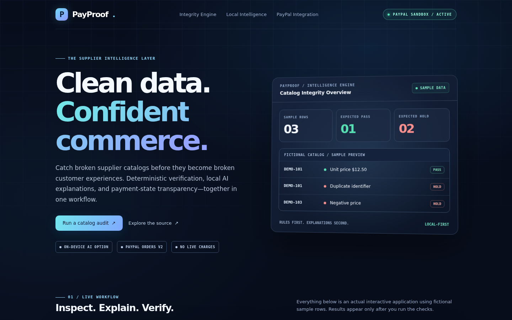

# PayProof — Supplier Data Integrity + PayPal AI Commerce

**Status: isolated prototype, NOT a production payment or AI service.**

PayProof validates supplier CSV data and demonstrates order creation plus a read-only status check using the PayPal Orders v2 **sandbox only**. Created as a small, independently licensed hackathon candidate by Bowleg Systems. This repository is **not** ATLAS's proprietary internal code.

## Why it exists

Small merchants import faulty supplier catalogs. This app catches invalid prices, duplicate SKUs and invalid identifiers, then demonstrates paying for a more complete workflow. A local-LLM explanation is optional and disabled by default. Automatic corrected-file delivery is **not implemented** and must not be claimed as completed.

## Run locally (zero external packages)

Requires Python 3.10+.

    python3 -m unittest discover -s tests -v
    python3 app.py

Open http://127.0.0.1:9087 — prepopulated sample is fictional.

The app binds to loopback and stores session state in process memory only. The CSV is not written to disk. The test suite makes no network calls.

## Optional local AI (owner-controlled, off by default)

Set PAYPROOF_LOCAL_MODEL to an Ollama model already approved for use on your own machine. Then POST /insights with a ticket or use the button in the preview. The prompt receives only aggregate validation counts and issue categories, **not** uploaded CSV text. It calls loopback Ollama only. Inference is explicitly constrained to CPU (num_gpu=0, 2 threads, immediate unload); this avoids using production GPU VRAM but still consumes some host CPU/RAM. Initial cold-start model inference can take roughly 45 seconds, depending on host load. Verify the available model lane and resource budget before enabling; never preempt ATLAS production GPUs for a hackathon.

## Payment modes

* **DEMO_NO_PAYMENT** (default): Create order simulates a checkout. It cannot transfer money, and its response clearly says so.
* **PAYPAL_SANDBOX**: set PAYPAL_SANDBOX_CLIENT_ID and PAYPAL_SANDBOX_SECRET in process environment. This uses https://api-m.sandbox.paypal.com exclusively to create PayPal Orders v2 and returns an approval URL.

Example, with credentials loaded **privately** into the shell (never committed):

    PAYPAL_SANDBOX_CLIENT_ID="$ID" PAYPAL_SANDBOX_SECRET="$SECRET" python3 app.py

The sandbox approval is a test transaction. The capture endpoint verifies the order ID, amount, currency, and capture status on the server. Do not treat sandbox captures as revenue.

## API

* GET /health — preview status
* POST /inspect — JSON with csv text, returns ticket, diagnostics and quote
* POST /insights — optional local AI report explanation; 503 when disabled
* POST /checkout — JSON with ticket, returns demo or sandbox order
* POST /order-status — JSON with ticket; retrieves the current PayPal sandbox order state WITHOUT a capture
* POST /capture — JSON with ticket and order_id; OPTIONAL untested buyer-approval/capture route, not needed for the published demo

Do **not** deploy this preview on a public interface. Before production, add authentication, persistent idempotent payment records, strict server-side amounts, CSRF protection, rate limits, event/webhook verification, no sensitive-data logs, a real privacy policy, and independent security verification.

## Hackathon status

Candidate for the **PayPal AI Hackathon** (deadline Nov 12, 2026). This prototype is **not yet eligible as a completed entry** because live local-AI inference verification, payment approval end-to-end, a public repo, a presentation/demo, and Devpost entry remain outstanding.

Optional secondary candidate: GitLab Transcend, but real GitLab Duo Agent Platform workflows and public CI history are required. This project does not claim either currently.

## Intellectual property and safety

Only fictional examples. Do not add private ATLAS logic, employer documents, customer data, token files, merchant credentials or corporate secrets. MIT license applies only to this standalone project. Check competition terms before public release.

Sources: https://paypalaihackathon.devpost.com/rules ; https://developer.paypal.com/api/rest/authentication ; https://developer.paypal.com/api/orders-v2/ .

## Hackathon submission materials

See [SUBMISSION_DRAFT.md](SUBMISSION_DRAFT.md) for a fact-checked pitch,
demo-video outline, important limitations and checklist. A public YouTube
demo video and PayPal sandbox credentials are not included in source code.

This project can be published on GitHub. Its release does not confer any
permission to publish or modify proprietary ATLAS production source.

## Interface preview

The updated responsive workbench provides visible pass/hold metrics,
deterministic row-by-row corrections, human-readable explanations, and
a downloadable JSON report. Its PayPal order-status check remains read-only.
The homepage's labeled sample preview is illustrative; measured results
only appear after running the local integrity check.

## Recording and Devpost submission

[Demo recording guide](DEMO_RECORDING_GUIDE.md) gives the actual browser
actions and a truthful narration script. [Submission draft](SUBMISSION_DRAFT.md)
contains prepared text for the competition entry. Public YouTube video and
the final Devpost entry are still required. Buyer approval and capture have
been skipped at the owner's direction; the documented demo demonstrates
actual sandbox order creation and read-only status instead.

## Real hackathon video

A redesigned **2-minute 11-second 1080p recording (R2)** of the actual running PayProof browser app
with offline narration is available in the
[PayProof R2 demo release](https://github.com/businessbowleg/atlas-payproof-hackathon-2026/releases/tag/payproof-demo-v2).
The R2 recording adds a redesigned visual workbench and natural narration. It demonstrates real CSV validation, a real local CPU-only model
response, PayPal sandbox order creation and read-only status checking.
It explicitly shows **CREATED, not PAID**. There is no transaction capture.

**Important:** GitHub-hosted video is NOT the required public YouTube video.
A public YouTube upload and Devpost submission remain outstanding.

## Candidate R3 (review branch only)

A separate reviewed-remediation branch adds local, human-approved CSV correction
with SHA-256 provenance and safe-export gating. See [R3_REVIEW.md](R3_REVIEW.md).
This is **not** in the approved R2 public main-branch baseline.
